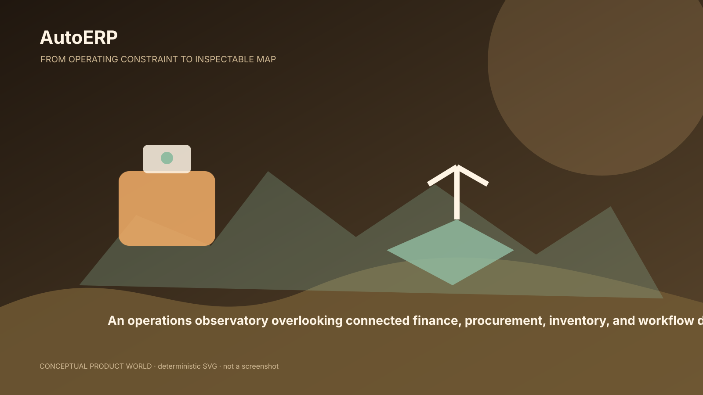
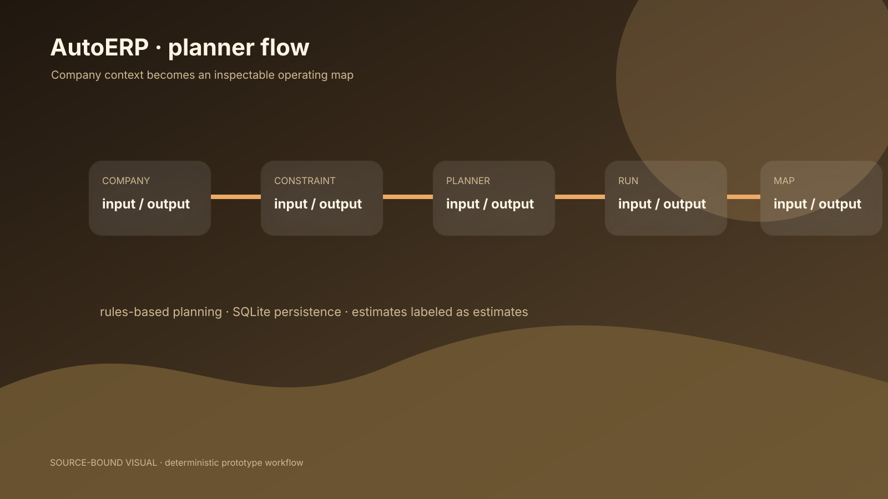
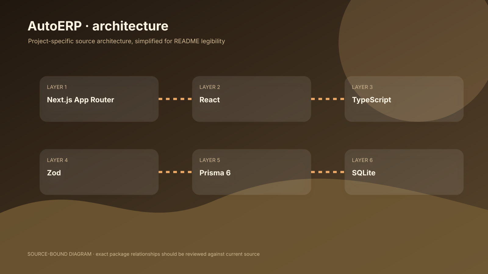

# AutoERP

> Turn an operating constraint into an inspectable map.

A deterministic ERP planning prototype that turns a company profile and operating constraint into a department map, bottleneck analysis, estimated opportunities, and a staged deployment roadmap.

[Demo route](https://autoerp.vercel.app/demo) · [NOAERTH](https://www.noaerth.com)



## The planner, not a production ERP

AutoERP is a prototype for the earliest ERP decision: where are the bottlenecks, which departments connect, and what would a staged deployment need to address? A user selects company size, departments, workflow focus, bottleneck, procurement complexity, and inventory profile. A validated command produces a stored run and a dashboard result.



The planner returns complexity and risk scores, department connections, automation opportunities, bottleneck stages, procurement and inventory estimates, financial-operation estimates, a four-phase roadmap, and a recommended tier. These are deterministic, rules-based estimates from `runEnterprisePlanner()`, not external AI output or validated financial forecasts.

## Quick start

```bash
`pnpm install`
`pnpm db:push`
`pnpm dev`
`pnpm build`
```

The default build pushes a local SQLite schema through Prisma. The core API surface is `POST /api/command`, `GET /api/command`, and `GET /api/command/[id]`.

## Architecture

Next.js App Router + React + TypeScript + Zod + Prisma 6 + SQLite + local deterministic planner



There is no authentication or tenant isolation in the inspected implementation. The dashboard should therefore be treated as a local prototype surface, not as a place for real company data.

## Evidence snapshot

| Evidence | Interpretation |
|---|---|
| 2 command API handlers | Source-backed; see `v4/VERIFIED_METRICS.json` for definition and status. |
| 0 local test files found | Source-backed; see `v4/VERIFIED_METRICS.json` for definition and status. |
| 4 roadmap phases returned by the planner | Source-backed; see `v4/VERIFIED_METRICS.json` for definition and status. |

## Boundaries

- Prototype, not a production ERP.
- Scores and savings are heuristic estimates.
- No authentication, tenant isolation, export, or rate limiting found.

## Source map

- `app/planner/page.tsx`
- `app/api/command/route.ts`
- `src/lib/autoerp-engine.ts`
- `src/lib/autoerp-data.ts`
- `prisma/schema.prisma`

## Status and next step

Prototype / active development. The next credible step is to validate the planner with real users and instrument first-value behavior before describing savings or operational outcomes as measured.
